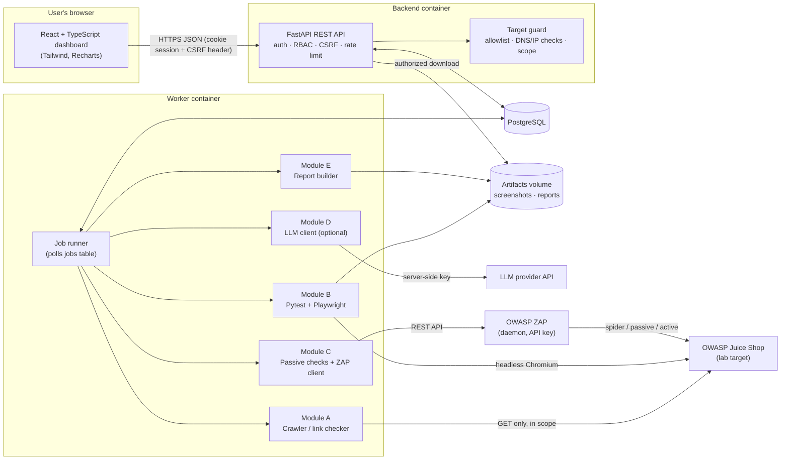
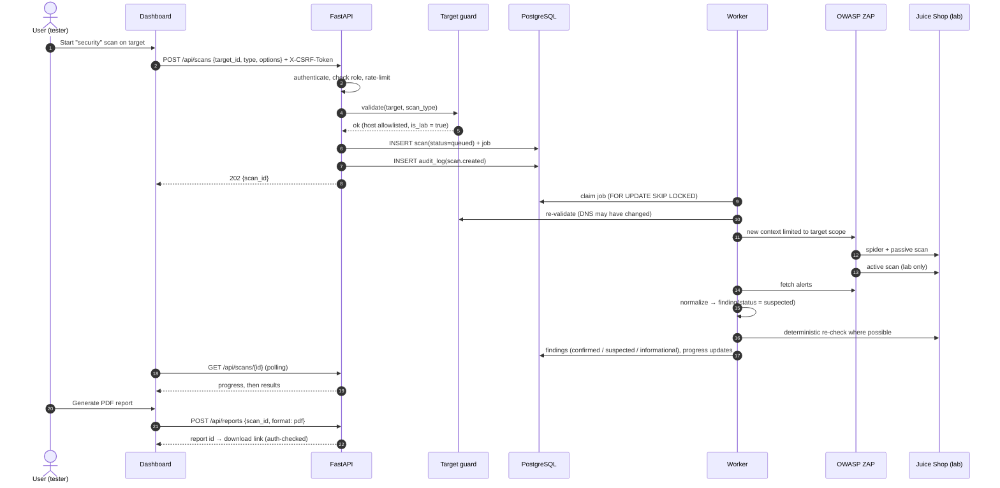
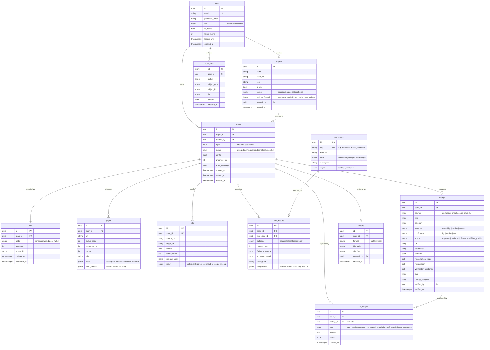

# SentinelQA — Architecture (Phase 1)

> Status: **design document**. Nothing described here is claimed to be implemented yet.
> Each section is implemented in the phase listed in `docs/ROADMAP.md`.

---

## 1. Requirements summary

### 1.1 What the platform does
SentinelQA lets an authenticated user register an **authorized target**, run scans against it, and get evidence-backed reports.

| Capability | Module | Type of activity |
|---|---|---|
| Availability, crawl, broken links, redirects, metadata, response times, basic accessibility | A — Scanner | Passive (normal HTTP GETs) |
| Login, registration, forms, invalid/empty/boundary input, navigation, search, session, logout, responsive layout | B — QA automation | Browser-driven (Playwright + Pytest) |
| Security headers, cookie flags, HTTP config, info disclosure, SQLi/XSS indicators, auth & access-control checks | C — Security | Passive checks + **active** OWASP ZAP scans (lab targets only) |
| Summaries, root-cause hints, remediation, requirement → draft tests, missing-scenario detection | D — AI (optional) | LLM via backend only |
| PDF / HTML / JSON reports | E — Reporting | Read-only over stored results |

### 1.2 Non-negotiable rules (they shape the whole design)
1. **No scan runs against a host that is not on the server-side allowlist.** The allowlist comes from environment configuration, not from the UI.
2. **Active security testing** (ZAP active scan, injection payloads) is only permitted for targets flagged `is_lab = true`, and only an `admin` can create such a target.
3. **Findings are classified** as `confirmed`, `suspected`, or `informational`. A scanner alert alone is never `confirmed`; confirmation requires a deterministic re-check or a human verification.
4. **AI output is stored separately** (`ai_insights` table) and is always labelled as AI-generated. It can never change a finding's status or a test's outcome.
5. **Test results only come from executed tests.** A result row is written by the runner after Pytest reports; there is no code path that writes "passed" by default.

---

## 2. High-level architecture



**Why a separate worker?** Scans take minutes. Running them inside an HTTP request would time out and block the API. The API only *creates a job*; the worker executes it and writes progress to the database, which the dashboard polls.

**Why no Redis/Celery?** We use a `jobs` table with `SELECT … FOR UPDATE SKIP LOCKED`. It is one less service to run and secure, it is easy to explain in an interview, and it is reliable at the scale of a single-team tool. (If you later need many workers, swapping in a queue is a contained change.)

---

## 3. Data flow (one security scan)



---

## 4. Technology choices (and why)

| Area | Choice | Reason |
|---|---|---|
| Language | Python 3.12 | Required; mature typing; best Playwright/Pytest/ZAP tooling. |
| API | FastAPI + Pydantic v2 | Typed request/response validation out of the box, automatic OpenAPI docs (useful for API testing and for recruiters). |
| ORM / migrations | SQLAlchemy 2 + Alembic | Industry standard; explicit migrations show professional DB practice. |
| Database | **PostgreSQL** in Docker; SQLite only for fast unit tests | Postgres gives row locking for the job queue, proper JSONB, and concurrency. |
| Browser automation | Playwright (Python) | Auto-waiting, reliable selectors, screenshots/traces on failure, headless Chromium in Docker. |
| Test runner | Pytest | Fixtures, parametrization (boundary values), JUnit XML output that the worker parses into results. |
| Security scanner | OWASP ZAP (official Docker image, daemon mode) | Industry-standard DAST; controlled through its REST API with an API key, called with `httpx` (no extra client library). |
| HTTP client | httpx | Sync + async, timeouts, redirect control (needed for redirect analysis and SSRF safety). |
| HTML parsing | BeautifulSoup + lxml | Link extraction, titles/meta, form/label checks. |
| Passwords | Argon2id (argon2-cffi) | Current OWASP recommendation for password hashing. |
| Sessions | Signed JWT in `HttpOnly; Secure; SameSite=Strict` cookie + CSRF double-submit token | Token is unreachable from JavaScript (XSS-resistant); CSRF token protects state-changing requests. |
| Rate limiting | slowapi | Small, FastAPI-compatible; protects login and scan endpoints. |
| Reports | Jinja2 (HTML), WeasyPrint (PDF from the same HTML), JSON from Pydantic | One template → two formats, so PDF and HTML never disagree. |
| AI | Provider-agnostic interface; first adapter for the Anthropic API | Optional; disabled when no key is set; key lives only in backend env. |
| Frontend | React + TypeScript + Vite, Tailwind CSS, TanStack Query, React Router, Recharts | Typed UI, cached/polling data fetching, charts. |
| Packaging | Docker Compose | One command brings up API, worker, DB, ZAP, Juice Shop, frontend. |
| CI | GitHub Actions | Lint, type-check, unit/API tests, browser tests against Juice Shop service container. |

Exact versions are pinned in Phase 2 (`backend/requirements.lock`, `frontend/package-lock.json`) after checking them against each other.

---

## 5. Security design

### 5.1 Target guard (SSRF and scope protection)
A scan target is accepted only if **all** checks pass, both when it is registered **and again in the worker immediately before every request batch**:

1. Scheme is `http` or `https`; no credentials in the URL; no fragments used for scope.
2. Hostname is in `ALLOWED_TARGET_HOSTS` (environment variable, exact match, lower-cased).
3. The hostname resolves, and **every** resolved IP is checked: cloud metadata ranges (`169.254.0.0/16`, `fd00:ec2::254`) are always blocked; loopback/private ranges are allowed **only** if the host is also listed in `ALLOWED_PRIVATE_LAB_HOSTS`.
4. Redirects are followed manually; every hop is re-validated. Leaving the target's origin ends that branch and is recorded as an "out-of-scope redirect" observation.
5. Crawl limits: max pages, max depth, max duration, per-request timeout, and a politeness delay — all with hard upper bounds enforced server-side.
6. Active security scans require `target.is_lab = true`, which only an admin can set and which requires the host to be in `ALLOWED_PRIVATE_LAB_HOSTS`.

Result: even a compromised `tester` account cannot point the platform at the internet or at internal services.

### 5.2 Platform security controls
| Control | Implementation |
|---|---|
| Authentication | Email + password, Argon2id, lockout/backoff after repeated failures |
| Authorization (RBAC) | `admin` (users, targets, lab flag, config), `tester` (run scans, verify findings, reports), `viewer` (read-only) |
| CSRF | Double-submit token on all POST/PUT/PATCH/DELETE |
| Rate limiting | Login: strict per IP + per account; scan creation: per user |
| Input validation | Pydantic schemas with length/format limits on every field |
| Error handling | Generic messages to clients; full detail only in server logs with a correlation ID |
| Secrets | `.env` (never committed) → container env; `.env.example` contains placeholders only |
| Audit log | Login success/failure, user/role changes, target changes, scan start/cancel, finding status changes, report downloads |
| Subprocess safety | Pytest launched with an argument list (never `shell=True`), fixed working directory, timeout, minimal env |
| File safety | Reports and screenshots stored under generated UUID names; downloads authorized per scan; no user-controlled paths |
| Headers | API and frontend send CSP, HSTS (when TLS), X-Content-Type-Options, frame-ancestors none |

A full STRIDE threat model is delivered in Phase 9 (`docs/THREAT_MODEL.md`).

### 5.3 Finding classification
| Status | Meaning | How it is reached |
|---|---|---|
| `suspected` | A tool reported something that may be a vulnerability | Default for every ZAP alert and heuristic indicator |
| `confirmed` | Reproduced deterministically or verified by a person | Automated re-check with stored request/response evidence, **or** a tester marks it verified (audited) |
| `informational` | Useful observation, not a vulnerability | e.g. server banner, missing optional header on a static asset |
| `false_positive` | Verified as not an issue | Tester action, audited |

Every finding stores: source, severity (`critical/high/medium/low/info`), confidence (`high/medium/low`), evidence (request, response excerpt, parameter), reproduction steps, remediation, CWE / OWASP Top 10 mapping, and manual verification guidance.

---

## 6. Database schema



Test credentials for target logins (e.g. a Juice Shop test account) are **never stored in the database**; `auth_profile_ref` only names environment variables.

---

## 7. Folder structure

```
sentinelqa/
├── backend/
│   ├── app/
│   │   ├── main.py                # FastAPI app factory, middleware
│   │   ├── config.py              # typed settings from env
│   │   ├── db.py                  # engine/session
│   │   ├── models/                # SQLAlchemy models
│   │   ├── schemas/               # Pydantic request/response models
│   │   ├── api/                   # routers: auth, users, targets, scans, findings, tests, reports, ai, audit
│   │   ├── security/              # passwords, tokens, csrf, rbac, rate limit, target_guard
│   │   ├── services/              # business logic used by API and worker
│   │   └── audit.py
│   ├── worker/
│   │   ├── runner.py              # job loop
│   │   ├── scanner/               # Module A
│   │   ├── qa/                    # Module B: launches pytest, parses JUnit XML
│   │   ├── security/              # Module C: passive checks, zap_client.py, verifiers
│   │   ├── ai/                    # Module D: provider interface + adapter
│   │   └── reports/               # Module E: templates, html/pdf/json builders
│   ├── qa_suites/                 # Playwright + Pytest suites run AGAINST targets
│   │   ├── conftest.py
│   │   ├── test_auth.py
│   │   ├── test_forms.py
│   │   ├── test_navigation.py
│   │   ├── test_search.py
│   │   ├── test_session.py
│   │   └── test_responsive.py
│   ├── tests/                     # tests OF the platform itself
│   │   ├── unit/
│   │   ├── integration/
│   │   ├── api/
│   │   └── security/
│   ├── alembic/
│   ├── pyproject.toml
│   ├── requirements.lock
│   └── Dockerfile
├── frontend/
│   ├── src/
│   │   ├── api/                   # typed client, CSRF handling
│   │   ├── components/
│   │   ├── pages/                 # Overview, Scans, Tests, Vulnerabilities, History, Reports, Configuration, Settings
│   │   ├── hooks/
│   │   └── main.tsx
│   ├── e2e/                       # Playwright tests of the dashboard
│   ├── package.json
│   └── Dockerfile
├── docs/
│   ├── ARCHITECTURE.md
│   ├── ROADMAP.md
│   ├── THREAT_MODEL.md            # Phase 9
│   ├── TROUBLESHOOTING.md         # Phase 10
│   └── screenshots/
├── samples/reports/               # sample reports generated from Juice Shop
├── .github/workflows/ci.yml
├── docker-compose.yml
├── .env.example
├── .gitignore
├── SECURITY.md
├── CONTRIBUTING.md
├── LICENSE
└── README.md
```

Note the distinction between `qa_suites/` (tests the platform runs **against a target website**) and `tests/` (tests that check **SentinelQA itself**). Recruiters notice this.

---

## 8. Feature breakdown → API surface

| Area | Endpoints (prefix `/api`) |
|---|---|
| Auth | `POST /auth/login`, `POST /auth/logout`, `GET /auth/me`, `GET /auth/csrf` |
| Users (admin) | `GET/POST /users`, `PATCH /users/{id}` |
| Targets | `GET/POST /targets`, `GET/PATCH/DELETE /targets/{id}` |
| Scans | `GET/POST /scans`, `GET /scans/{id}`, `POST /scans/{id}/cancel`, `GET /scans/{id}/pages`, `GET /scans/{id}/links` |
| QA results | `GET /scans/{id}/tests`, `GET /tests/{id}/screenshot` |
| Findings | `GET /findings?severity=&status=&q=`, `GET /findings/{id}`, `PATCH /findings/{id}` (verify / false positive) |
| Reports | `POST /reports`, `GET /reports`, `GET /reports/{id}/download` |
| AI | `POST /ai/scans/{id}/summary`, `POST /ai/findings/{id}/explain`, `POST /ai/draft-tests` |
| Dashboard | `GET /stats/overview` |
| Audit (admin) | `GET /audit` |
| Health | `GET /health` |
